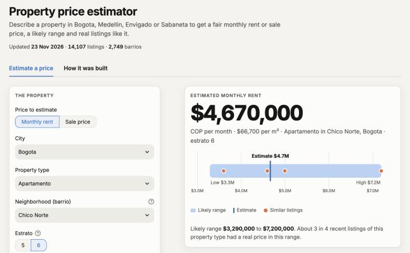
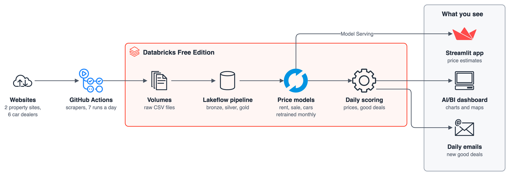
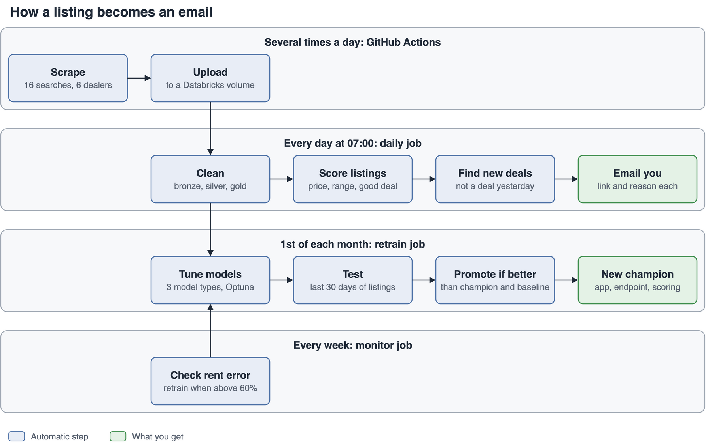
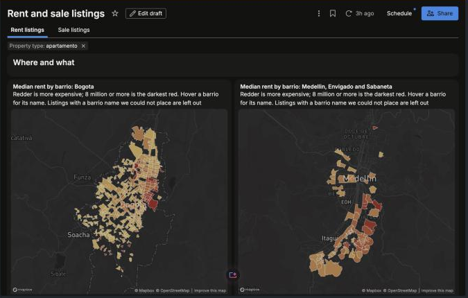
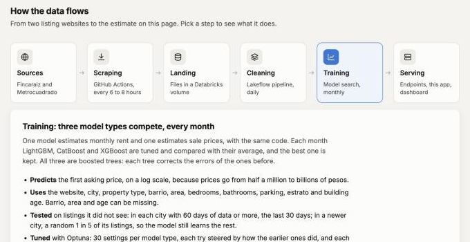
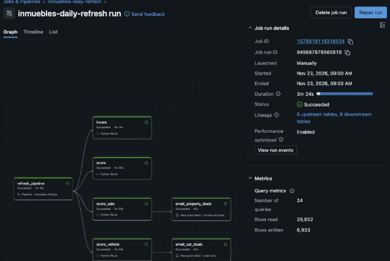
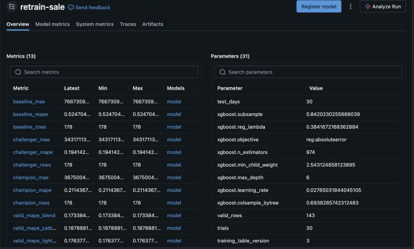
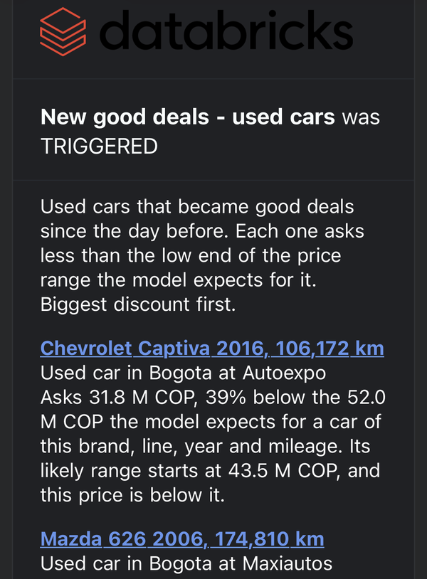
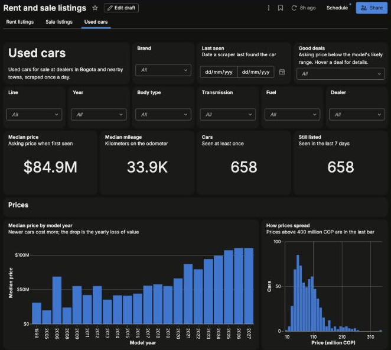

# Colombian Rent, Sale and Used-Car Prices

> **DISCLAIMER**: This project is for academic and educational purposes only. It demonstrates web scraping techniques, config-driven design, and data extraction patterns. Not intended for commercial use or large-scale data harvesting. Users are responsible for complying with applicable laws and website Terms of Service.

An end-to-end data and machine learning project. It scrapes property listings (rentals and sales in Bogota, Medellin, Envigado and Sabaneta) and used cars from six dealers, then on Databricks it cleans them, learns what each listing should cost, flags the good deals and sends them by email every morning.



## What it does

- **Collects listings every day.** GitHub Actions runs 16 property searches on Fincaraiz and Metrocuadrado 7 times a day, and scrapes six used-car dealers once a day. Each run sends its files straight to Databricks.
- **Cleans them in a medallion pipeline.** A Lakeflow pipeline loads only new files (Auto Loader), then builds bronze, silver and gold tables for properties and for cars. Data rules drop broken rows, and each listing gets one row per day.
- **Predicts three prices.** One model for monthly rent, one for sale price and one for used-car price. Each month, Optuna tunes LightGBM, CatBoost and XGBoost, and the best one or their average wins.
- **Gives a likely range, not only a number.** Each estimate comes with a low and a high price, taken from the model's real errors on unseen listings.
- **Never promotes a worse model.** A new version becomes the champion only if it beats both the old champion and a simple baseline on the same test listings. A weekly check starts a retrain when the rent error grows too much.
- **Finds good deals.** Every day, each active listing is priced. A listing is a good deal when it asks less than the low end of its likely range.
- **Emails the new deals.** Two emails a day, one for houses and apartments for sale and one for used cars. Each deal has a link and the reason it is a deal. A deal more than 50% below the model price carries a warning, because that is often a data error.
- **Shows it all.** A Streamlit app (estimate a price, see similar listings, and a clickable diagram of how it was built), an AI/BI dashboard with barrio maps, two model serving endpoints and a Genie space for questions in plain language.

## Architecture



The [Databricks README](databricks/README.md) has the table-level diagram, every design decision and the setup steps. Both diagrams are draw.io files in `docs/diagrams/`; the architecture PNG holds its own diagram, so it also opens in draw.io.

## How it works



1. **Scrape.** The property scrapers are config-driven: each site is one entry in `config.yaml` with XPath selectors, run with Scrapy or Playwright. They first collect listing URLs from the search pages, then open each listing. The car scraper reads each dealer's own catalog feed (WordPress, WooCommerce, PrestaShop or Next.js JSON) and writes every dealer to the same columns.
2. **Upload.** Each GitHub Actions run uploads its new CSV files to a Unity Catalog volume. Databricks keeps the only lasting copy, so a failed upload fails the run and GitHub sends an email. Each run also keeps its files as an artifact for 90 days.
3. **Clean.** The daily job (07:00 Bogota time) refreshes the pipeline. Bronze keeps the raw rows. Silver parses prices, areas and rooms with built-in Spark functions and drops rows that break a data rule. Gold has one table each for rentals, sales and cars.
4. **Train.** On the 1st of each month, each model is retrained. It is tested on the listings first seen in the last 30 days (or on a random 1 in 5 for cities and models with less than 60 days of data). The winner gets the `retador` alias, and becomes `campeon` only if it is better. The training job also points the rent and sale serving endpoints at their champion; the app runs the car model itself.
5. **Score.** After the refresh, the daily job prices every active listing, stores the price and its range, flags the good deals and keeps each day's deals in a history table.
6. **Tell.** Right after scoring, two Databricks SQL alerts compare today's deals with the previous day's and email only the new ones. No mail service or key is needed: Databricks sends them.
7. **Watch.** A weekly monitor checks the rent model's error on new listings and starts a retrain when it passes the limit. A backtest measures how the error grows 1, 2 and 3 months after training.

## Results

Test error (MAPE: the average percentage miss) on listings the model did not train on, against a simple baseline.

| Model | Model error | Baseline error | Tested on |
|---|---|---|---|
| Rent | 38% | 81% (median of the barrio) | Listings first seen in the last 30 days, local run on data up to 22 Nov 2026 |
| Sale | 19.4% | 52.5% (median of the barrio) | A random 1 in 5 of the first days of data, retrain of Nov 2026 |
| Used cars | 10.4% | 19.8% (median of the same line and year) | A random 1 in 5 of the first scrape, 23 Nov 2026 |

The rent error is high because most recent rentals have no area (a scraper problem, now fixed) and because the listings say nothing about condition or finishes. The sale and car numbers will look worse once they are tested on later months. The app shows the live numbers of each model.

## Screenshots

| | |
|---|---|
|  |  |
| Dashboard: median price per barrio in Bogota and in Medellin, Envigado and Sabaneta | App: the clickable diagram of how the estimate is built |
|  |  |
| The daily job: refresh, locate barrios, score the three models, email the new deals | A monthly retrain in MLflow: each candidate's error and the tuned settings |
|  |  |
| The daily email: each new deal with its link and why it is a deal | Dashboard: the Used cars page, with filters, counters and prices by model year |

More in [Running on Databricks](databricks/README.md#running-on-databricks).

## Repository layout

```
scraping_listings/
├── .github/workflows/      # Scheduled scrapers that upload to Databricks
├── app/
│   ├── main.py             # Property scraper entry point (scrape)
│   ├── models/             # Pydantic models
│   ├── scrapers/           # Scrapy and Playwright implementations
│   ├── services/           # Config loader, data saver
│   ├── utils/              # Shadow DOM utilities
│   └── vehicles/           # Used-car dealer scrapers (scrape-vehicles)
├── databricks/             # Databricks bundle: pipeline, models, jobs, alerts, dashboard, app
├── docs/diagrams/          # Architecture and process diagrams (draw.io)
├── tests/                  # Scraper tests (fixtures, no network)
├── config.yaml             # Property scraper configurations
├── analyze_artifacts.ipynb # Local analysis notebook
└── pyproject.toml          # Dependencies
```

## Run the scrapers

### Install

```bash
git clone https://github.com/LGuillermoAngaritaG/scraping_listings.git
cd scraping_listings
```

```bash
# Install uv (recommended)
curl -LsSf https://astral.sh/uv/install.sh | sh

# Create virtual environment
uv venv
source .venv/bin/activate  # Windows: .venv\Scripts\activate

# Install project
uv pip install -e .

# Install Playwright browsers (if using Playwright scrapers)
playwright install chromium
playwright install-deps chromium
```

```bash
scrape --help
```

### Properties

```bash
# Run a scraper by name (from config.yaml)
scrape fincaraiz-bogota-leasing
scrape metrocuadrado-bogota-sale
```

Each run writes CSV files to `data/`:

```
data/
├── fincaraiz-bogota-leasing_pages_20241016_140530.csv
└── fincaraiz-bogota-leasing_details_20241016_140612.csv
```

Features:

- Two-phase scraping: extract URLs from search pages, then details from individual listings
- Config-driven: define scrapers in `config.yaml` with XPath selectors
- Automatic pagination handling
- Shadow DOM support for modern web components
- Incremental CSV saving (data saved continuously)

### Used cars

```bash
scrape-vehicles all        # every dealer, one after the other
scrape-vehicles casatoro   # one dealer: autoexpo, casatoro, autonal, maxiautos, madiautos, metrousados
```

Each dealer is one module in `app/vehicles/`, which reads the dealer's own catalog feed or its pages, at most one request a second per site. Every dealer is written to the same columns, one file per dealer and run:

```
data/vehicles-casatoro_20261123_081339.csv
source, listing_id, url, title, brand, line, version, year, km, price_cop, transmission, fuel,
body_type, engine_cc, color, plate_digit, city, branch, scraped_at
```

Only the last digit of a plate is kept; full plates and VINs are never written.

### Configuration

Scrapers are defined in `config.yaml`. Basic structure:

```yaml
scrapers:
  - name: fincaraiz-bogota-leasing
    scrapying_engine: scrapy  # or playwright
    number_of_pages: 5  # 0=infinite, 1=no pagination, N=limit
    base_url: https://www.fincaraiz.com.co
    pages_url: https://www.fincaraiz.com.co/arriendo/bogota/bogota-dc
    next_xpath: //*[@id="__next"]//li[last()]/a/@href
    urls_xpath: //a[@class="lc-data"]/@href

    information:
      - name: title
        xpath: //*[@id="__next"]//h1/text()

      - name: pricing
        xpath: //div[@class="property-price-tag"]//p[@class="main-price"]/text()
```

Each site has one full entry. The other searches (other cities, sales) reuse its XPaths with a YAML merge key and change only the name and the URL. Names follow `<site>-<city>-<leasing|sale>`; the pipeline reads the city and the operation from them.

```yaml
  - <<: *fincaraiz
    name: fincaraiz-medellin-sale
    pages_url: https://www.fincaraiz.com.co/venta/medellin/antioquia
```

## Automation

Three workflows run the scrapers on GitHub Actions. Each property search runs as its own parallel job:

| Workflow | Schedule | Searches | Databricks volume |
|---|---|---|---|
| Fincaraiz (`scrape-fincaraiz.yml`) | Every 6 hours | Rent and sale in Bogota, Medellin, Envigado and Sabaneta | `csv_diarios` |
| Metrocuadrado (`scrape-metrocuadrado.yml`) | Every 8 hours | The same 8 searches | `csv_diarios` |
| Used cars (`scrape-vehicles.yml`) | Once a day, 03:17 Colombia time | All six dealers in one job | `csv_vehiculos` |

To run one by hand: **Actions** tab on GitHub, pick the workflow, **Run workflow**.

The scraped files are not stored in this repository. Each run:

- Uploads its new files to a Databricks volume, which keeps the only lasting copy. The run fails when an upload fails or the `DATABRICKS_HOST` and `DATABRICKS_TOKEN` secrets are missing.
- Keeps its files as a run artifact for 90 days, the backup to upload again by hand.

The CSV history up to 23 Nov 2026 was in `data/` and is still in git history. The local Databricks tests and the notebook need it. To get it back (the files are ignored by git, so they stay local):

```bash
git restore --source "$(git log -1 --format=%H --diff-filter=D -- data)~1" -- data
```

## Ethical considerations

- Always check `robots.txt` before scraping
- Use reasonable rate limiting
- Review website Terms of Service
- Do not scrape personal information
- This tool is for educational/research purposes only

**Users are solely responsible for ensuring their use complies with applicable laws.**

## License

MIT License - see LICENSE file for details.
