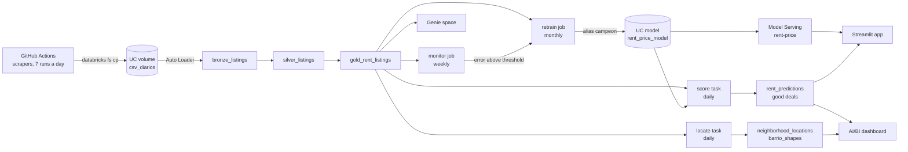

# Rent price prediction on Databricks

Predicts the monthly rent of a property in Bogota from the listings this repo scrapes.
Built for Databricks Free Edition as a portfolio project.



## What is here

| Path | What it does |
|---|---|
| `databricks.yml`, `resources/` | Bundle: schema, 2 volumes, MLflow experiment, pipeline, 4 jobs |
| `src/pipeline/listings.py` | All parsing and cleaning logic (plain PySpark, no UDFs) |
| `src/pipeline/transformations/` | Lakeflow pipeline: bronze (Auto Loader), silver, gold |
| `src/ml/rent_model.py` | Features, LightGBM model, baseline, metrics, price range, backtest |
| `src/ml/banded_model.py` | The registered model: returns prediction, low and high |
| `src/ml/train.py` | Retrain job: challenger vs champion, promotion, serving endpoint |
| `src/ml/monitor.py` | Weekly error check, starts retraining |
| `src/ml/score.py` | Daily: prices active listings, flags good deals (rent_predictions) |
| `src/ml/locate.py` | Daily: matches neighborhood names to official barrios and their outlines (neighborhood_locations, barrio_shapes) |
| `src/ml/backtest.py` | Error 1, 2 and 3 months after training |
| `app/` | Separate bundle for the Streamlit app |
| `dashboard/rent_eda.lvdash.json` | EDA dashboard, deployed with the bundle |
| `dashboard/queries.sql` | Extra model-monitoring queries to add to a dashboard by hand |
| `scripts/backfill.sh` | One-time upload of the CSV history in git |
| `tests/` | Local tests on the real CSV files |

## Decisions

| Topic | Decision | Why |
|---|---|---|
| Ingestion | GitHub Action pushes each new CSV to a volume | Free Edition limits outbound internet |
| Incremental load | Auto Loader into bronze | Reads only new files |
| Catalog | `workspace` (Free Edition default) | Creating catalogs is unreliable on Free Edition |
| Parsing | Regex on the scraper's text field, built-in Spark functions only | No Python UDFs, so nothing to ship to executors |
| Deduplication | One row per source, property and day; a valid row wins, then the latest | Scrapers run 3 to 4 times a day |
| Models | Rent only | The scrapers collect rentals only. A sale model needs a sale scraper first |
| Target | First asking price, split by first seen date | The test never sees a price from the future |
| Algorithm | LightGBM on log(price) | Tabular data, wide price range, runs on CPU |
| Baseline | Median price of the neighborhood | Simple bar the model must beat |
| Promotion | New version gets alias `retador`; `campeon` moves only if MAPE beats both baseline and champion on the same last 30 days | Never promote a worse model. MAPE because rents go from 0.5 M to 30 M COP |
| Data version | Training copies gold into `rent_training_data` and logs its Delta version | Materialized views have no time travel |
| Daily trigger | Daily schedule | File arrival triggers are not confirmed on Free Edition. The swap is one line in `resources/jobs.yml` |
| Retraining | Monthly, plus weekly monitor that starts it when MAPE > 60% | The local backtest shows error grows slowly (48% to 53% in 3 months). Lower the threshold once area data is back |
| Price range | The model returns low, prediction and high. Low and high come from the 10th and 90th percentile of real price / predicted price on the test month, per property type | Simple and checked on held-out data: about 3 in 4 prices of the next month fall inside. Two extra quantile models gave the same coverage with more to train and serve |
| Serving | Endpoint created or updated from the training job | The endpoint needs a model version, which exists only after training |
| App | Own bundle, deployed after the first training | Its endpoint must exist at deploy time |

## Setup (once)

1. Create a Databricks Free Edition account. Verify your identity to raise limits.
2. Install the Databricks CLI and log in. Recent Homebrew versions ask you to trust the tap first (`brew trust databricks/tap`):
   ```bash
   brew tap databricks/tap && brew install databricks
   ```
   ```bash
   databricks auth login --host https://<your-workspace>.cloud.databricks.com
   ```
3. From the `databricks/` folder, deploy the bundle. It creates the schema `workspace.inmuebles`, the volume, the pipeline and the jobs. Run all later commands from this folder too:
   ```bash
   databricks bundle deploy
   ```
4. Upload the CSV history already in git:
   ```bash
   scripts/backfill.sh
   ```
   Then the public map data for the neighborhood map. The listings only have a neighborhood name; the daily `locate` task matches it to Bogota's cadastral sectors (barrios, open data, CC BY 4.0) and to OpenStreetMap neighbourhood names (ODbL), which include many market names. Refresh these two files once a year:
   ```bash
   curl -L -o sector.zip "https://datosabiertos.bogota.gov.co/dataset/6f5031cf-07d0-42c3-ba5c-4436eba0a2d9/resource/428a5f4e-b9d4-4d91-88a7-28fb404a08ab/download/sector.geojson.10.26.zip" && unzip -o sector.zip
   curl -o osm_places.json --data-urlencode 'data=[out:json][timeout:90];(node["place"~"^(neighbourhood|suburb|quarter)$"](4.45,-74.25,4.85,-73.98);way["place"~"^(neighbourhood|suburb|quarter)$"](4.45,-74.25,4.85,-73.98);relation["place"~"^(neighbourhood|suburb|quarter)$"](4.45,-74.25,4.85,-73.98););out center tags;' https://maps.mail.ru/osm/tools/overpass/api/interpreter
   databricks fs cp SECTOR.geojson dbfs:/Volumes/workspace/inmuebles/reference/ --overwrite
   databricks fs cp osm_places.json dbfs:/Volumes/workspace/inmuebles/reference/ --overwrite
   ```
   The sector file name has a version (`10.26`); take the newest link from the dataset page. Any Overpass server works; the main one was not reachable from here.
5. Create a personal access token (Settings > Developer). Add two repository secrets in GitHub: `DATABRICKS_HOST` and `DATABRICKS_TOKEN`. From then on, each scraper run uploads its new file.
6. Build the tables, train the first model and run the backtest:
   ```bash
   databricks bundle run daily_refresh
   ```
   ```bash
   databricks bundle run retrain
   ```
   ```bash
   databricks bundle run backtest
   ```
7. Deploy the app (after step 6 created the `rent-price` endpoint):
   ```bash
   cd app && databricks bundle deploy && databricks bundle run rent_price_app
   ```
   The first time you open the app, Databricks asks you to authorize it.
   The app asks for property type, barrio (searchable), estrato, bedrooms, bathrooms and parking. Area and building age are optional. The estrato list shows only the estratos found in that barrio's listings. It shows the estimate, a strip chart with the likely range and the prices of similar listings, then up to 5 similar listings from the same barrio as cards. A card shows "Good deal" when the daily scoring flagged that listing. The look (colors, Inter font) is set in `app/src/.streamlit/config.toml`; the font loads from Google Fonts in the viewer's browser. It reads the gold and predictions tables through the SQL warehouse; the bundle gives it read access.
8. The EDA dashboard "Bogota rent listings" is deployed with the bundle in step 3 and shows data once the pipeline has run (Dashboards in the sidebar). It has filters for property type (apartments by default), neighborhood, estrato, bedrooms, bathrooms and parking, plus a "Last seen" date range and a "Good deals" filter (pick "Good deals only"); KPIs; sections for prices, where and what (a map that fills each official barrio by its median rent, 8 million or more in the darkest red, a neighborhood table, a median-rent heatmap by estrato and bedrooms, listings by type), and a table of listings with first and last seen dates and a Deal column. Hover a Deal cell to read what a good deal is. Colors and font are set in the file's `uiSettings.theme`.
9. In the UI: create a Genie space on `gold_rent_listings` and `rent_predictions`. Example questions: "median rent of apartments in Chico by month", "which neighborhoods are most expensive per m²".

## How to check each phase

| Phase | Check |
|---|---|
| Ingestion | `databricks fs ls dbfs:/Volumes/workspace/inmuebles/csv_diarios` shows today's files |
| Medallion | Pipeline graph shows dropped rows per rule; lineage is visible in Catalog Explorer. `SELECT source, property_id, scrape_date, COUNT(*) FROM workspace.inmuebles.silver_listings GROUP BY ALL HAVING COUNT(*) > 1` returns nothing |
| Daily job | Three days of `inmuebles-daily-refresh` runs with no manual action |
| Backtest | `backtest_results` table and the chart in the MLflow experiment |
| Training | At least three runs in the experiment; `challenger_mape` < `baseline_mape` |
| Retraining | One run with tag `promoted=True` and one with `promoted=False` |
| Monitoring | Set `--mape-threshold=0.01` in `resources/jobs.yml`, deploy, `databricks bundle run monitor`; it must start `inmuebles-retrain`. Set it back |
| Serving | `databricks serving-endpoints query rent-price --json '{"dataframe_records": [...]}'` returns a price |

## Local results (data up to 22 Nov 2026)

From the local tests (one file per source and day, same code as the jobs). Not yet run on Databricks.

| Check | Result |
|---|---|
| Test window | Listings first seen in the last 30 days: 1,424 rows; 7,580 for training |
| Model MAPE / MAE | 38% / 8.8 M COP |
| Baseline (median of the neighborhood) MAPE | 81% |
| MAPE by type | apartaestudio 21%, apartamento 26%, casa 31%, oficina 56%, bodega 60%, local comercial 69% |
| Backtest MAPE, 1 / 2 / 3 months after training | 48% / 51% / 53% (baseline about 100%) |

Most recent rows have no area: Metrocuadrado lost it from Feb to Nov 2026 and Fincaraiz saved 404 pages in the same months. Both scrapers are fixed, so error should drop as new data comes in. Commercial properties (offices, warehouses, shops) are the weak spot.

## Local tests

They run the same parsing, cleaning and model code on the real CSV files with a local Spark (needs Java 17+):

```bash
cd databricks && uv sync && uv run pytest -s
```

## Limits to keep in mind

- Free Edition: serverless only, one active pipeline per type, 5 concurrent job tasks, CPU serving only, up to 3 apps.
- Apps stop 24 hours after start or redeploy. Start it again before a demo: `databricks bundle run rent_price_app`.
- Over the daily quota, compute stops until the next day. Data is kept.
- Free Edition is for non-commercial use only.
- The map places about 3 in 4 listings. The rest have a barrio name that is in neither map source (for example "chico reservado") or no name. A market name ("chico navarra") is drawn as the official barrio its OpenStreetMap point falls in, so the map shows where rents are high, not exact addresses.
- `databricks bundle destroy` deletes the schema with all tables and the volume.
