# Rent, sale and used-car price prediction on Databricks

Predicts the monthly rent or the sale price of a property in Bogota, Medellin, Envigado and Sabaneta, and the asking price of a used car at a dealer, from the listings this repo scrapes.
Built for Databricks Free Edition as a portfolio project.

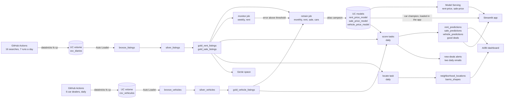

## Running on Databricks

Screenshots from the Free Edition workspace, 22 and 23 Nov 2026. Emails are hidden.

**Lakeflow pipeline.** One update reads the new CSV files (bronze), cleans them (silver drops 44K rows that break a data rule) and builds the rent and sale tables (gold).

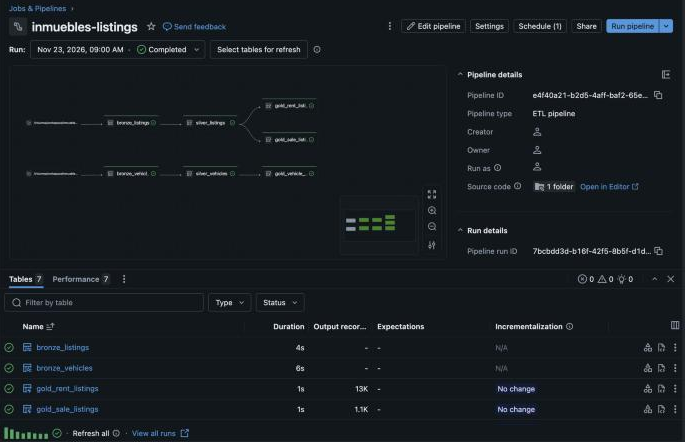

**Daily job.** Refreshes the pipeline, then places listings on the map (`locate`) and prices every active listing with both models (`score`, `score_sale`).

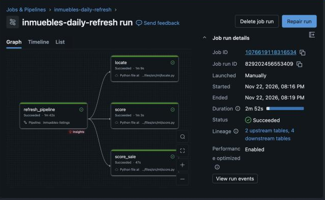

**Training run in MLflow.** The monthly sale retrain: the validation error of each candidate (`valid_mape_*`), the test error of the new model (`challenger_mape` 19.4%) against the old champion (21.1%) and the barrio median (52.5%), and the tuned settings.

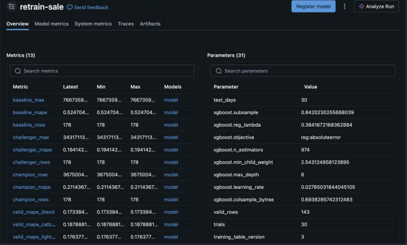

**Unity Catalog.** The tables of the `inmuebles` schema and the rent model versions. Version 5 has the alias `campeon` and is served by `rent-price`; version 6 is the latest challenger (`retador`), not promoted.

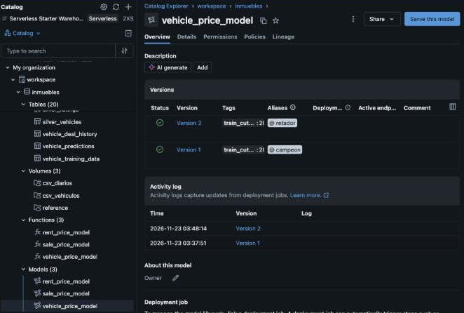

**Model Serving.** Both endpoints are ready: rent serves version 5, sale version 2.

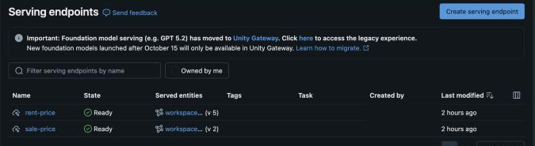

**AI/BI dashboard.** Rent trend and spread, and the barrio maps of Bogota and of Medellin, Envigado and Sabaneta.

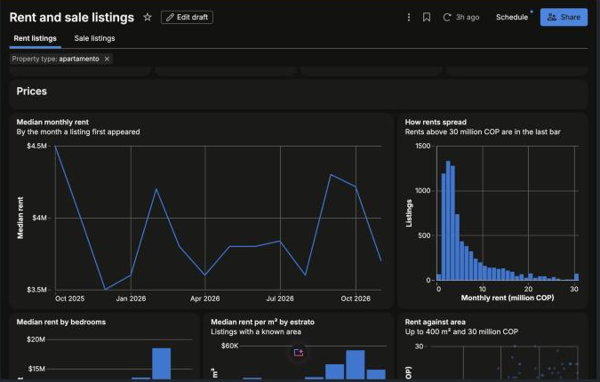

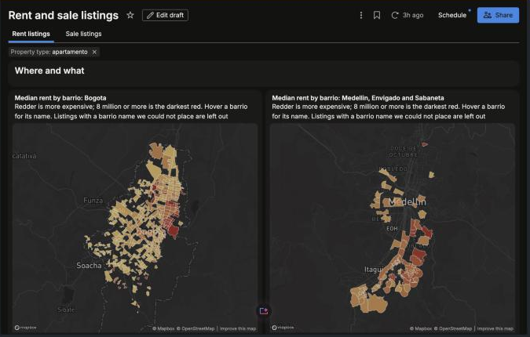

**Databricks App.** An estimate with its likely range, the clickable diagram of how it was built, and the live model cards.

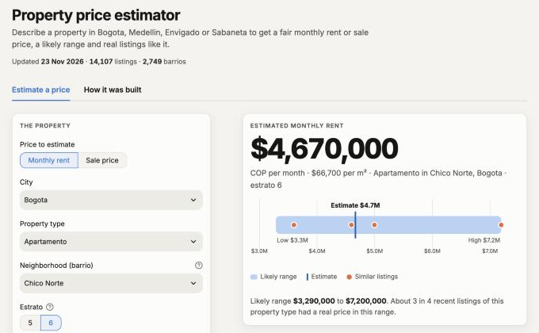

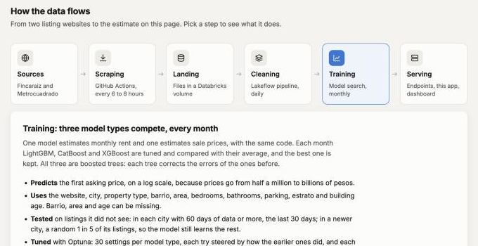

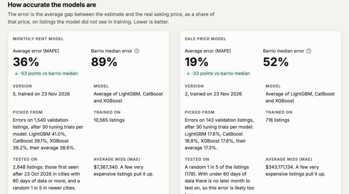

## What is here

| Path | What it does |
|---|---|
| `databricks.yml`, `resources/` | Bundle: schema, 3 volumes, MLflow experiment, pipeline, 4 jobs, 2 new-deals alerts, dashboard |
| `src/pipeline/listings.py` | All parsing and cleaning logic (plain PySpark, no UDFs) |
| `src/pipeline/vehicles.py` | Used-car cleaning: types, rules, one row per car and day, one row per car |
| `src/pipeline/transformations/` | Lakeflow pipeline: bronze (Auto Loader), silver, gold for rent and for sale; the same three layers for used cars (`vehicle_tables.py`) |
| `src/ml/rent_model.py` | Features, the three model types and their average, split, baseline, metrics, price range, backtest (used by both models) |
| `src/ml/model_search.py` | Monthly model search: Optuna tuning of each model type on a validation slice, then the best of them and their average |
| `src/ml/vehicle_model.py` | What differs for used cars: columns, baseline (median of the same brand, line and year) and the good-deal rule |
| `src/ml/banded_model.py` | The registered model: returns prediction, low and high |
| `src/ml/train.py` | Retrain job, once per model (`--listings rent`, `sale` or `vehicle`): challenger vs champion, promotion, serving endpoint |
| `src/ml/monitor.py` | Weekly error check, starts retraining |
| `src/ml/score.py` | Daily, once per model: prices active listings, flags good deals (rent_predictions, sale_predictions, vehicle_predictions) and keeps each day's deals (rent_deal_history, sale_deal_history, vehicle_deal_history) |
| `src/ml/locate.py` | Daily: matches neighborhood names, city by city, to barrios and their outlines (neighborhood_locations, barrio_shapes) |
| `src/ml/backtest.py` | Error 1, 2 and 3 months after training |
| `app/` | Separate bundle for the Streamlit app |
| `dashboard/rent_eda.lvdash.json` | EDA dashboard with a rent page, a sales page and a used-car page, deployed with the bundle |
| `dashboard/queries.sql` | Extra model-monitoring queries to add to a dashboard by hand |
| `scripts/backfill.sh` | One-time upload of the CSV history (restored from git history, see Setup step 4) |
| `scripts/aburra_osm.py` | Yearly: OpenStreetMap places and town outlines of the Aburra valley, for the map |
| `scripts/barrio_areas.py` | Yearly: approximate barrio areas for Envigado and Sabaneta, for the map |
| `tests/` | Local tests on the real CSV files (restored from git history, see Local tests) |

## Decisions

| Topic | Decision | Why |
|---|---|---|
| Ingestion | GitHub Action pushes each new CSV to a volume, and since 23 Nov 2026 only there: the files were removed from the repository and stay in git history | Free Edition limits outbound internet. The repository is public, so it no longer publishes the listings. The volume is the only lasting copy, so a failed upload fails the run, and GitHub keeps each run's files for 90 days to upload again |
| Incremental load | Auto Loader into bronze | Reads only new files |
| Catalog | `workspace` (Free Edition default) | Creating catalogs is unreliable on Free Edition |
| Parsing | Regex on the scraper's text field, built-in Spark functions only | No Python UDFs, so nothing to ship to executors |
| Deduplication | One row per source, property and day; a valid row wins, then the latest | Scrapers run 3 to 4 times a day |
| Models | One for rent, one for sale, one for used cars, same code | Sale prices are in the hundreds of millions of COP, rents in the millions, and a rent is not a fixed share of the price. Each has its own registered model, endpoint and promotion. A car has other columns, so `train.py` and `score.py` take the columns, baseline and good-deal rule from `rent_model.py` or `vehicle_model.py` |
| Used cars | Own volume and tables; the scrapers write the same flat columns for every dealer, so silver only casts types and checks rules (price 5 M to 3,000 M COP, year 1980 to next year, mileage up to 1 M km) | The property bronze reads every file in its volume. Mapping each dealer's fields in Python, with fixture tests, is easier than in Spark |
| City | Taken from the search that found the listing, and a model feature next to the neighborhood | Barrio names repeat across cities (La Castellana is in Bogota and in Medellin). The baseline uses city and neighborhood together |
| Split by city | A city with 60 days of data or more is tested on its last 30 days; a newer city on a random 1 in 5 of its listings. Every city is in training | A time split needs a past to train on. With one cutoff for all cities, a city added last month would be all test and the model would never learn it. The `split` parameter of each run says `temporal`, `mixed` or `random` |
| Target | First asking price, split by first seen date | The test never sees a price from the future |
| Algorithm | Boosted trees on log(price): LightGBM, CatBoost and XGBoost, each tuned, and their average. The lowest validation MAPE wins | Tabular data, wide price range, runs on CPU. In a Nov 2026 test on the data of rent version 4, tuning cut the rent test error from 37.4% to 36.1-36.7% and the average to 35.0%. Random forest (39.1%), a linear model (45.1%) and a small neural net (40.8%) were worse, and adding them made the average worse |
| Tuning | Optuna, 30 trials per model type (`--trials`). Each trial stops adding trees after 100 without improvement. Scored on a validation slice cut from the training rows with the same per-city rule as the test | The test rows stay unseen until the final comparison with the champion. The final model is refit on all training rows with the number of trees scaled to their size |
| Baseline | Median price of the neighborhood; for cars, of the same brand, line and year (then line, then brand) | Simple bar the model must beat |
| Promotion | New version gets alias `retador`; `campeon` moves only if MAPE beats both baseline and champion on the same last 30 days | Never promote a worse model. MAPE because rents go from 0.5 M to 30 M COP |
| Data version | Training copies gold into `rent_training_data` and logs its Delta version | Materialized views have no time travel |
| New-deals emails | Two Databricks SQL alerts (`resources/alerts.yml`), one for houses and apartments for sale and one for used cars, each run by the daily job right after its scoring | Databricks sends the email itself, so there is no mail service or key. Rentals and other property types (offices, lots, fincas) are kept in history but not emailed. A deal is new when it was not a deal on the previous scoring day, so a price cut counts too. Each deal is one entry with a link to the listing and the reason: asking price, the price the model expects, the discount and the low end of the likely range. So the email needs no dashboard. A deal more than 50% below the model price gets a warning to check the listing, because the largest one in the first email was a data error (a 4,800 m2 apartment). The alert's own schedule is paused, so it runs only after a successful scoring. On the first day there is no history, so that email lists every current deal |
| Daily trigger | Daily schedule | File arrival triggers are not confirmed on Free Edition. The swap is one line in `resources/jobs.yml` |
| Retraining | Monthly, plus weekly monitor that starts it when MAPE > 60% | The local backtest shows error grows slowly (48% to 53% in 3 months). Lower the threshold once area data is back |
| Price range | The model returns low, prediction and high. Low and high come from the 10th and 90th percentile of real price / predicted price on the test month, per property type | Simple and checked on held-out data: about 3 in 4 prices of the next month fall inside. Two extra quantile models gave the same coverage with more to train and serve |
| Car model in the app | The app loads the car champion from Unity Catalog and runs it (the app is a uv project on Python 3.12 with the training versions); no endpoint | Free Edition allows two serving endpoints and its serving quota fits only two models: a third endpoint, or the car model as a second model on the sale endpoint, were both refused (Nov 2026). The app gets EXECUTE on the model through a FUNCTION grant, the type Unity Catalog uses for registered models |
| Serving | Endpoint created or updated from the training job. Every run checks that it serves the champion and moves it if not. Rent, sale and used cars train one after the other | The endpoint needs a model version, which exists only after training. Two endpoint updates at once go over the Free Edition serving quota; in Nov 2026 that left rent version 5 as champion while the endpoint still served version 4 |
| App | Own bundle, deployed after the first training | Its endpoint must exist at deploy time |

## Setup (once)

1. Create a Databricks Free Edition account. Verify your identity to raise limits.
2. Install the Databricks CLI and log in. Recent Homebrew versions ask you to trust the tap first (`brew trust databricks/tap`):
   ```bash
   brew tap databricks/tap && brew install databricks
   ```
   ```bash
   databricks auth login --host https://<your-workspace>.cloud.databricks.com
   ```
3. From the `databricks/` folder, deploy the bundle. It creates the schema `workspace.inmuebles`, the volume, the pipeline and the jobs. Run all later commands from this folder too:
   ```bash
   databricks bundle deploy
   ```
4. Upload the CSV history up to 23 Nov 2026. It is in git history only, so restore it first (from the repository root; git ignores the restored files):
   ```bash
   cd .. && git restore --source "$(git log -1 --format=%H --diff-filter=D -- data)~1" -- data && cd databricks
   ```
   ```bash
   scripts/backfill.sh
   ```
   And the used-car files of a local `scrape-vehicles all` run (they are not in git):
   ```bash
   for f in ../data/vehicles-*.csv; do databricks fs cp "$f" "dbfs:/Volumes/workspace/inmuebles/csv_vehiculos/$(basename "$f")" --overwrite; done
   ```
   Then the public map data for the neighborhood maps. The listings only have a neighborhood name; the daily `locate` task matches it, city by city, to official barrios and to OpenStreetMap neighbourhood names (ODbL), which include many market names. Refresh these files once a year. Bogota: the cadastral sectors (barrios, open data, CC BY 4.0) and OpenStreetMap places:
   ```bash
   curl -L -o sector.zip "https://datosabiertos.bogota.gov.co/dataset/6f5031cf-07d0-42c3-ba5c-4436eba0a2d9/resource/428a5f4e-b9d4-4d91-88a7-28fb404a08ab/download/sector.geojson.10.26.zip" && unzip -o sector.zip
   curl -o osm_places.json --data-urlencode 'data=[out:json][timeout:90];(node["place"~"^(neighbourhood|suburb|quarter)$"](4.45,-74.25,4.85,-73.98);way["place"~"^(neighbourhood|suburb|quarter)$"](4.45,-74.25,4.85,-73.98);relation["place"~"^(neighbourhood|suburb|quarter)$"](4.45,-74.25,4.85,-73.98););out center tags;' https://maps.mail.ru/osm/tools/overpass/api/interpreter
   databricks fs cp SECTOR.geojson dbfs:/Volumes/workspace/inmuebles/reference/ --overwrite
   databricks fs cp osm_places.json dbfs:/Volumes/workspace/inmuebles/reference/ --overwrite
   ```
   The sector file name has a version (`10.26`); take the newest link from the dataset page. Any Overpass server works; the main one was not reachable from here.
   Medellin: the official barrios and veredas from the city's map server (it refuses requests without a browser user agent):
   ```bash
   curl -A "Mozilla/5.0" -o medellin_barrios.geojson "https://www.medellin.gov.co/servidormapas/rest/services/ServiciosCatastro/Base_Catastral/MapServer/1/query?where=1%3D1&outFields=*&outSR=4326&f=geojson"
   ```
   Medellin, Envigado and Sabaneta: OpenStreetMap places and town outlines, cut from the Geofabrik extract of Colombia (about 320 MB). Take the newest dated file from https://download.geofabrik.de/south-america/colombia.html; the `latest` link can point to a file that is gone:
   ```bash
   curl -L -o colombia.osm.pbf https://download.geofabrik.de/south-america/colombia-261121.osm.pbf
   uvx --from osmium python scripts/aburra_osm.py colombia.osm.pbf aburra_osm.geojson
   ```
   Envigado and Sabaneta publish no barrio outlines, and OpenStreetMap has almost none there. Their open data has points with a barrio name (Envigado traffic accidents, Sabaneta streetlights); the script turns them into approximate barrio areas:
   ```bash
   curl -G -o envigado_accidents.json https://www.datos.gov.co/resource/t5sw-amxr.json --data-urlencode '$select=barrio,area,coordenadas' --data-urlencode '$where=coordenadas IS NOT NULL' --data-urlencode '$limit=50000'
   curl -G -o sabaneta_lights.json https://www.datos.gov.co/resource/5upz-u2vi.json --data-urlencode '$select=barrio,latitud_n,longitud_w' --data-urlencode '$limit=10000'
   uvx --with shapely python scripts/barrio_areas.py aburra_osm.geojson envigado_accidents.json sabaneta_lights.json envigado_sabaneta_barrios.geojson
   ```
   ```bash
   for f in medellin_barrios.geojson aburra_osm.geojson envigado_sabaneta_barrios.geojson; do databricks fs cp $f dbfs:/Volumes/workspace/inmuebles/reference/ --overwrite; done
   ```
5. Create a personal access token (Settings > Developer). Add two repository secrets in GitHub: `DATABRICKS_HOST` and `DATABRICKS_TOKEN`. From then on, each scraper run uploads its new file. A failed upload fails the run, and the run's files stay in its GitHub artifact for 90 days.
6. Build the tables, train the first rent, sale and used-car models, score the listings with them and run the backtest:
   ```bash
   databricks bundle run daily_refresh
   ```
   ```bash
   databricks bundle run retrain
   ```
   ```bash
   databricks bundle run daily_refresh
   ```
   ```bash
   databricks bundle run backtest
   ```
7. Deploy the app (after step 6 created the `rent-price` and `sale-price` endpoints, the car model and the predictions tables). First set `experiment_id` in `app/databricks.yml` to the id of your training experiment:
   ```bash
   databricks experiments get-by-name /Users/<you>/inmuebles-rent-price
   ```
   ```bash
   cd app && databricks bundle deploy && databricks bundle run rent_price_app
   ```
   The first time you open the app, Databricks asks you to authorize it.
   The app has three tabs. "Property price" first asks for monthly rent or sale price and the city, then property type, barrio (searchable, from that city), estrato, bedrooms, bathrooms and parking. Barrio, area and building age are optional: "Any barrio" sends the model `unknown`, the value training gives a listing without a barrio (a test checks the model stays close to its usual error then). The estrato list shows only the estratos found in that barrio's (or city's) listings. It shows the estimate, a strip chart with the likely range and the prices of similar listings, then up to 5 similar listings from the same barrio (or city) as cards. A card shows "Good deal" when the daily scoring flagged that listing. The look (colors, Inter font) is set in `app/src/.streamlit/config.toml`; the font loads from Google Fonts in the viewer's browser. It reads the gold and predictions tables through the SQL warehouse; the bundle gives it read access. Estimates are rounded (rent to 10,000 COP, cars to 100,000 COP, sale to 1,000,000 COP), since the error is far larger than that. "Car price" asks for brand, line (from that brand's cars), model year, mileage, city, transmission, fuel, body type and, optionally, engine size; the defaults are the most common values for that line. The model also learned which dealer listed a car, so the app sends the dealer with the most cars of that line. It shows the estimate and its range the same way, then up to 5 cars of the same brand and line, closest year and mileage first. "How it was built" opens with a diagram of the six steps from the websites to the estimate; clicking a step shows what it does, its tools and its numbers (plain HTML and CSS, no JavaScript). It then explains the models and their limits. Its numbers are live: listing counts from the gold tables, and for each model the version its endpoint serves with the metrics of the training run that built it and the result of the latest retrain (read from the MLflow experiment, which the bundle lets the app read). The tab loads only when opened.
8. The EDA dashboard "Rent and sale listings" is deployed with the bundle in step 3 and shows data once the pipeline has run (Dashboards in the sidebar). It has a page for rentals and a page for sales with the same layout, and a "Used cars" page with filters for brand, line, year, body type, transmission, fuel, dealer, last seen and good deals; KPIs; median price by model year, brand and body type; price against mileage; a brands and lines table; and a table of every car with its model price and Deal column. Each page has filters for city, property type (apartments by default), neighborhood, estrato, bedrooms, bathrooms and parking, plus a "Last seen" date range and a "Good deals" filter (pick "Good deals only"); KPIs; sections for prices, where and what (two maps, one for Bogota and one for Medellin, Envigado and Sabaneta, that fill each barrio by its median price, 8 million (rent) or 2,000 million (sale) or more in the darkest red, a neighborhood table, a median-rent heatmap by estrato and bedrooms, listings by type), and a table of listings with first and last seen dates, a Deal column and a Model price column (the price the model expects; only listings seen in the last 7 days are scored). Hover a Deal cell to read what a good deal is. Colors and font are set in the file's `uiSettings.theme`. The bundle also deploys two alerts (Alerts in the sidebar): "New good deals - houses and apartments for sale" and "New good deals - used cars". The daily job runs each one right after its scoring, and each emails the bundle user the listings that became good deals since the day before: each with a link to the listing and why it is a deal, biggest discount first. A day with no new deals sends no email.
9. In the UI: create a Genie space on `gold_rent_listings`, `gold_sale_listings`, `gold_vehicle_listings`, `rent_predictions`, `sale_predictions` and `vehicle_predictions`. Example questions: "median rent of apartments in Chico by month", "which neighborhoods are most expensive per m²".

## How to check each phase

| Phase | Check |
|---|---|
| Ingestion | `databricks fs ls dbfs:/Volumes/workspace/inmuebles/csv_diarios` shows today's files |
| Medallion | Pipeline graph shows dropped rows per rule; lineage is visible in Catalog Explorer. `SELECT source, property_id, scrape_date, COUNT(*) FROM workspace.inmuebles.silver_listings GROUP BY ALL HAVING COUNT(*) > 1` returns nothing |
| Daily job | Three days of `inmuebles-daily-refresh` runs with no manual action |
| Backtest | `backtest_results` table and the chart in the MLflow experiment |
| Training | At least three runs in the experiment; `challenger_mape` < `baseline_mape` |
| Retraining | One run with tag `promoted=True` and one with `promoted=False` |
| Model search | Each run has a `model` parameter, `valid_mape_*` metrics for the four candidates and a `trials_*.json` table per model type; `model` is the candidate with the lowest `valid_mape_*` |
| Monitoring (rent only) | Set `--mape-threshold=0.01` in `resources/jobs.yml`, deploy, `databricks bundle run monitor`; it must start `inmuebles-retrain`. Set it back |
| Serving | `databricks serving-endpoints query rent-price --json '{"dataframe_records": [...]}'` returns a price |

## Local results (data up to 22 Nov 2026)

From the local tests (one file per source and day, same code as the jobs). The live numbers are in the app's model cards above.

| Check | Result |
|---|---|
| Test window | Listings first seen in the last 30 days: 1,424 rows; 7,580 for training |
| Model MAPE / MAE | 38% / 8.8 M COP |
| Baseline (median of the neighborhood) MAPE | 81% |
| MAPE by type | apartaestudio 21%, apartamento 26%, casa 31%, oficina 56%, bodega 60%, local comercial 69% |
| Backtest MAPE, 1 / 2 / 3 months after training | 48% / 51% / 53% (baseline about 100%) |
| Used cars, first scrape of 23 Nov 2026 | 686 cars, a random 1 in 5 for testing (5 tuning trials): MAPE 10.4% against 19.8% for the median of the same line and year |

Most recent rows have no area: Metrocuadrado lost it from Feb to Nov 2026 and Fincaraiz saved 404 pages in the same months. Both scrapers are fixed, so error should drop as new data comes in. Commercial properties (offices, warehouses, shops) are the weak spot.

## Local tests

They run the same parsing, cleaning and model code on the real CSV files with a local Spark (needs Java 17+). The property files come from git history (restore them once, from the repository root), the car files from a local `scrape-vehicles all` run:

```bash
git restore --source "$(git log -1 --format=%H --diff-filter=D -- data)~1" -- data
```

```bash
cd databricks && uv sync && uv run pytest -s
```

## Limits to keep in mind

- Free Edition: serverless only, one active pipeline per type, 5 concurrent job tasks, CPU serving only, up to 3 apps.
- Apps stop 24 hours after start or redeploy. Start it again before a demo: `databricks bundle run rent_price_app`.
- Over the daily quota, compute stops until the next day. Data is kept.
- Free Edition is for non-commercial use only.
- The city is the city searched. About 3 in 100 listings are in a neighboring city (mostly Medellin listings found by the Envigado search).
- The maps place about 3 in 4 listings in Bogota, 85 in 100 in Medellin, 1 in 2 in Envigado and 2 in 3 in Sabaneta. The rest have a barrio name that is in no map source (for example "chico reservado", "cumbres", "aves maria"), only the city name, or no name. A market name ("chico navarra") is drawn as the barrio its OpenStreetMap point falls in, so the maps show where prices are high, not exact addresses.
- The Envigado and Sabaneta barrio areas are approximate: built from points with a barrio name, not from official outlines. Borders can be off by a block or two, and rural land with no points stays blank.
- Medellin, Envigado and Sabaneta were added on 22 Nov 2026. Their estimates rest on a few hundred listings each, and until they have 60 days of data their error is measured on a random 1 in 5 of the same days, so it looks better than it will be on new listings.
- The sale model started on 22 Nov 2026 with one day of data. Until there are 60 days, its error is measured on a random 1 in 5 of the same days, not on a later month, so it looks better than it will be on new listings.
- Used cars come from six dealers, mostly in Bogota and nearby towns (Chia, Funza, Villavicencio), and only 8 in Medellin. Collection started on 23 Nov 2026, so until there are 60 days the car model is tested on a random 1 in 5 of the same days and its error looks better than it will be on new cars. Metrousados publishes no body type, so most of its cars have none.
- The monthly retrain takes about 20 to 30 minutes per model on serverless, including the endpoint update (30 Optuna trials for each of three model types). Lower `--trials` in `resources/jobs.yml` if the Free Edition quota runs short.
- `databricks bundle destroy` deletes the schema with all tables and the volume.
